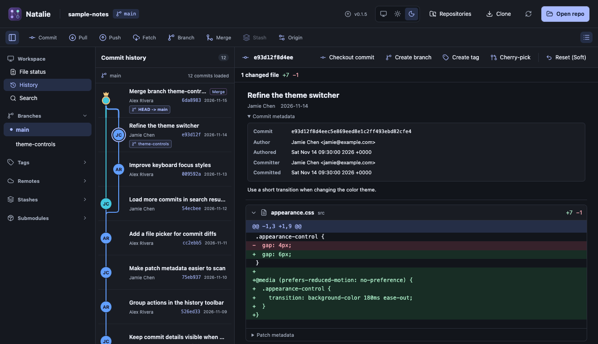

# Natalie

Natalie is a macOS Git client for reviewing diffs, staging changes, creating commits, and browsing a commit graph across local branches.



## Download

Get the Apple Silicon DMG from [GitHub Releases](https://github.com/duckfollow/natalie/releases/latest). Open the DMG and drag Natalie into Applications. Natalie uses Git at `/usr/bin/git`.

The build is signed ad hoc and has no Apple notarization. If macOS blocks the first launch and you trust the download from GitHub Releases, try opening Natalie, then use **System Settings → Privacy & Security → Open Anyway** if offered. See [Apple’s instructions](https://support.apple.com/en-us/102445).

## Using Natalie

- Choose **Open repo** to open a local working tree. Natalie uses your repository’s Git configuration and commit hooks.
- Open **History** to browse the commit graph, or use **Search** to find commits by subject, author, hash, or ref. Both views load more commits as you scroll.
- Use **Fetch** to update remote branches. History uses dashed lines and an **Incoming** label for commits that a local branch can pull from its upstream, even when another branch is checked out.
- Use **Repositories** to reopen a recent working tree or **Clone** to clone an HTTPS or SSH Git URL. Clone uses the credentials configured for Git and does not open a terminal credential prompt.

## HTTPS credentials

Open **Credentials** in the Git toolbar, select a remote, and enter the username and access token required by your Git provider. Natalie stores the token in macOS Keychain for that remote’s HTTPS push URL and configures Git to match the repository path. A fetch URL that matches the push URL can use the same credential.

## Run from source

Install Node.js and Rust on macOS, then run:

```sh
npm install
npm run dev
```

## macOS signing

Local builds use ad-hoc bundle signing (`bundle.macOS.signingIdentity: "-"`).
Verify the packaged app before distributing it:

```sh
codesign --verify --deep --strict --verbose=2 src-tauri/target/release/bundle/macos/Natalie.app
```

Ad-hoc signing does not provide Developer ID trust or Apple notarization. For
public distribution, override the local identity with `APPLE_SIGNING_IDENTITY`
using a Developer ID Application certificate and configure notarization credentials
as described in the [Tauri macOS signing guide](https://v2.tauri.app/distribute/sign/macos/).
Do not modify the app bundle after signing.
